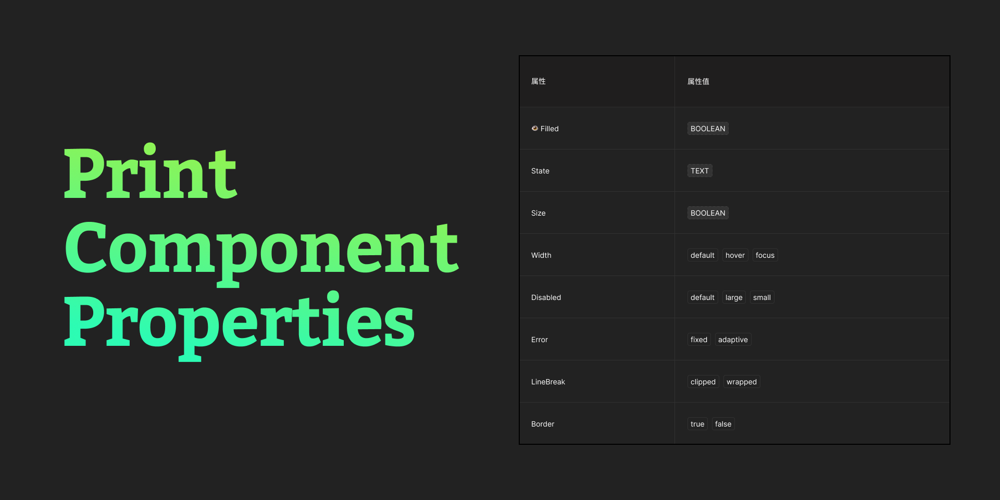
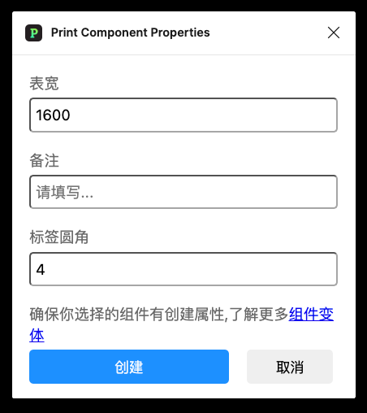
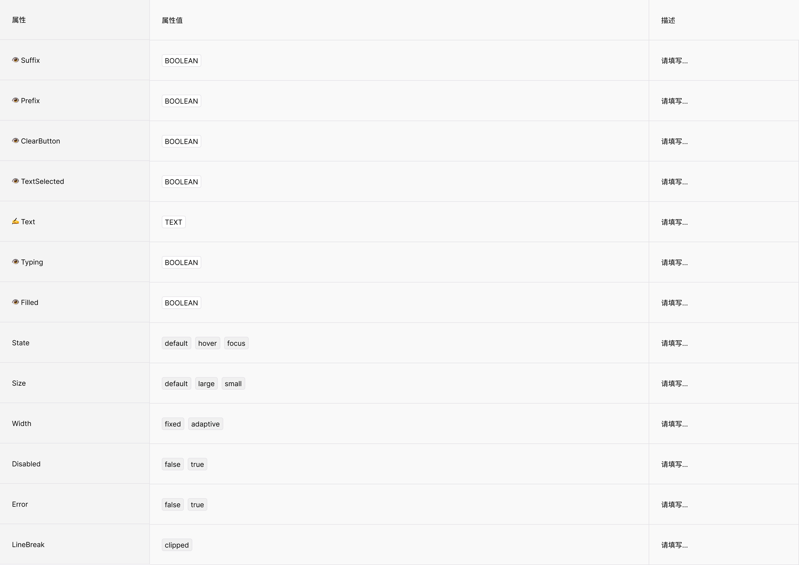

# 使用手册

01. 下载插件安装包到本地

02. Figma 选择开发->通过manifest文件导入插件

03. 选择manifest.json文件打开

04. 选择运行插件

----

# 功能介绍

01. Step01: 选择组件运行脚本（确保其配置有属性否则会报错）

02. Step02: 设置表宽、备注占位描述、标签圆角属性，点击创建

03. Step03: 默认在组件左边创建表格

04. Step04: 修改你的描述文案

## v1.0.1

- 表头与正文逐行取三列中的最大高度，消除列间累计错位，并垂直居中内容。
- 插件菜单名称为 `Print Component Properties · 行高修复版`。
- 下载仓库后，在 Figma 桌面端通过 Plugins → Development → Import plugin from manifest 导入 `manifest.json`；仓库已包含可运行的 `code.js`。
