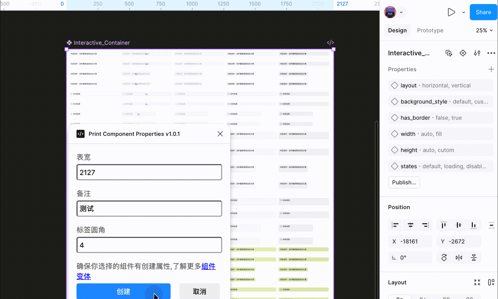

# Print Component Properties

把 Figma 组件集的属性整理成一张可编辑的说明表。

选中组件集，设置表宽、备注和标签圆角，即可在画布上生成「属性 / 属性值 / 描述」三列表格。适合整理组件库、补充设计规范，以及设计与开发交接时说明组件的可选配置。

## 完整演示

从设置参数到生成表格，查看完整操作过程：

## 功能介绍

- **整理组件属性**：读取所选组件集的属性定义，展示属性名称。
- **展开变体选项**：变体属性以标签展示可选值；其他属性展示类型，例如 `BOOLEAN`、`TEXT`。
- **生成可编辑表格**：在组件集左侧生成 Figma 图层，可继续填写每项属性的说明。
- **自定义输出**：支持表宽、统一备注占位文案和标签圆角。
- **逐行对齐**：v1.0.1 按同一行三列的最大高度对齐表头与单元格，避免逐行累计错位。

### 01 · 选择组件集

选中一个已配置属性的组件集（Component Set），再运行插件。请选中整个组件集，而不是其中一个变体或实例。

  

### 02 · 设置输出参数

填写表宽、备注占位文案和标签圆角，然后点击「创建」。表宽支持 900–2000，标签圆角输入范围为 0–20。

  

### 03 · 补充属性说明

表格默认生成在组件集左侧。生成后可直接编辑「描述」列，补充使用条件、状态含义或交互约定。

  

功能截图展示操作步骤；最新版本的完整操作见上方 GIF。

## 安装与使用

1. [下载仓库 ZIP](https://github.com/shengjun89/PrintComponentProperties/archive/refs/heads/main.zip) 并解压到固定目录。
2. 在 Figma 桌面端打开设计文件。
3. 选择 **Plugins → Development → Import plugin from manifest…**，打开仓库中的 `manifest.json`。
4. 选中一个组件集，运行 **Print Component Properties · 行高修复版**。
5. 设置参数并点击「创建」。

仓库包含可运行的 `code.js`，安装时无需构建。开发插件依赖本地文件，请保留解压目录；移动或删除目录后，需要重新导入。

## 使用范围

- 每次处理一个组件集。
- 表格是生成时的属性快照，不会随源组件自动更新。
- 生成结果包含属性定义和变体选项，不是每个变体的视觉缩略图。
- 插件使用 `PingFang SC` 与 `Inter` 字体，运行环境需能加载这些字体。

## 更新记录

### v1.0.1

- 修复表头及正文单元格跨列高度不一致的问题。
- 按每行最大高度统一三列，内容垂直居中。
- 菜单名称增加「行高修复版」，窗口标题展示版本号，方便区分旧插件。
